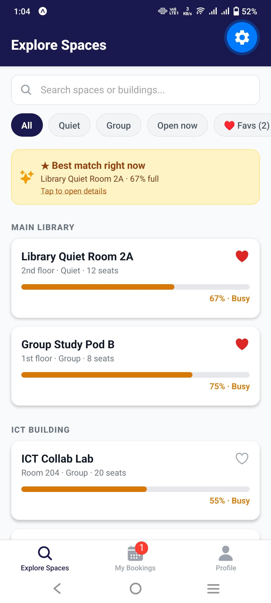
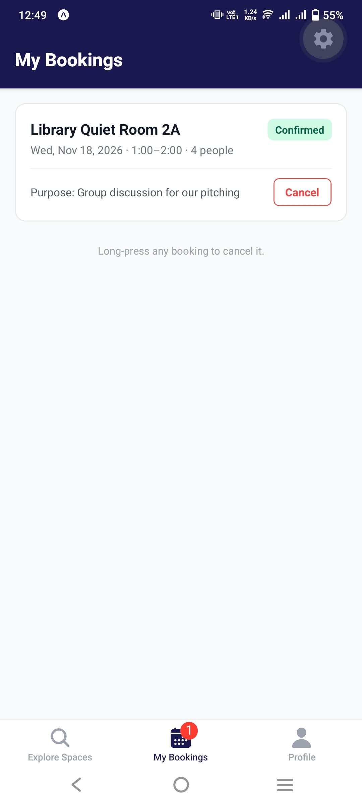

# StudySpot: A Campus Study-Space Finder & Booking App

**Course:** IT 313 – Mobile Programming (React Native)  
**Student:** Danica Almonia  
**Section:** BSIT-3R2

---

## 1. Problem Summary
Finding a quiet, available place to study on campus is a daily struggle for university students. Study spaces often become overcrowded without notice, and students waste time walking between buildings to check for seats. 

**StudySpot** solves this by providing a centralized mobile platform where students can:
- Browse and search study spaces across campus buildings in real-time.
- View live visual occupancy bars with color-coded congestion levels.
- Inspect space amenities, location, and available time slots.
- Reserve a slot with custom group sizes and purpose of use.
- Manage active bookings and maintain a list of favorite spaces.

---

## 2. Navigator Structure & Route Parameters

The application uses **React Navigation 7** with a nested navigation architecture:

```text
Root Stack Navigator (Native Stack)
├── [Signed Out] LoginScreen (headerShown: false)
└── [Signed In]
    ├── Main (Bottom Tabs Navigator)
    │   ├── ExploreScreen (Explore Spaces)
    │   ├── BookingsScreen (My Bookings with active badge)
    │   └── ProfileScreen (Student details & settings)
    ├── SpaceDetailsScreen (Space Details with favorite header action)
    └── BookingModalScreen (Modal presentation for slot reservation)
```

### Route Parameters:
* **`SpaceDetails`**: `{ spaceId: string }` — *Only the unique space ID is passed (never the full object).*
* **`BookingModal`**: `{ spaceId: string }` — *Only the unique space ID is passed.*

---

## 3. Innovation & Custom Features

### 1. "Best Match Right Now" Banner (Required Innovation)
* **Location:** Prominently featured at the top of the Explore screen.
* **Algorithm / Rule:** Scans all available spaces in real-time to recommend the space with `type === 'Quiet'` that has the **lowest occupancy ratio** (`occupied / seats`) and still has at least one open, unbooked time slot.
* **Interaction:** Tapping the banner immediately opens `SpaceDetails` for that recommended room. If all quiet rooms are fully booked, it displays an informative fallback message.

### 2. "Favorites Only" Filter Shortcut (Custom Enhancement)
* **Location:** Included in the filter chip row on the Explore screen (`♥ Favs`).
* **Functionality:** Features a dynamic count of the student's saved favorites. Tapping the chip isolates the `SectionList` to display only favorited spaces across campus. It updates live when a space is favorited or unfavorited.

---

## 4. How to Install and Run

### Prerequisites
* Node.js (v18 or higher recommended)
* Expo Go app on your Android or iOS device

### Installation
1. Clone this repository:
   ```bash
   git clone https://github.com/Danica-1011/IT313_Almonia_Danica_StudySpot.git
   cd IT313_Almonia_Danica_StudySpot
   ```
2. Install dependencies:
   ```bash
   npm install
   ```
3. Start the Expo development server:
   ```bash
   npx expo start
   ```
4. Scan the QR code using:
   - **Android**: Expo Go app
   - **iOS**: Camera app

---

## 5. Screenshots

| 1. Login Screen | 2. Explore & Best Match |
| :---: | :---: |
|  |  |

| 3. Space Details | 4. Booking Modal |
| :---: | :---: |
|  |  |
